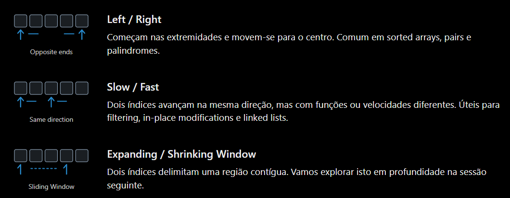

## Fundamentals

Em vez de percorrermos um array várias vezes com nested loops,
utilizamos **dois índices que se movem estrategicamente**.

Existem três variantes comuns

### Objetivo
Perceber quando podemos evitar comparações desnecessárias através
do movimento dos pointers, frequentemente conseguindo ``O(n)`` time e
``O(1)`` auxiliary space